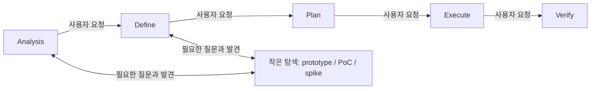

# Analysis: 아이디어를 작게 만들어 확인하는 활동의 워크플로 위치

작성: 2026-10-28. 현재 단계: Analysis.
사용자 요청: 아이디어가 되는지 확인하거나 눈으로 보는 데 적합한 Matt prototype 및 다른 스킬을 비교하고, 현재 워크플로에서 들어갈 자리를 분석한다.

시각 자료: [HTML 분석 문서](prototype-and-workflow.html). 질문별 확인 방법과 단계별 역할을 선택해 비교할 수 있다.

후속 분석: [HTML 제작 과정의 원인과 개선 조언](html-process-analysis.md).

이 문서의 권고는 분석 결과다. 스킬 추가·수정, 목표 요구사항 확정, 프로토타입 제작은 아직 수행하지 않았다.

## Concept

### 1. 같은 “한번 만들어 보자”에도 다른 질문이 있다

아래 명칭은 이번 분석에서 질문을 구분하기 위한 용법이다. 업계 전체에서 고정된 정의라는 주장은 아니다.

| 알고 싶은 것 | 적합한 수단 | 필요한 관찰·증거 | 그 결과만으로 알 수 없는 것 |
|---|---|---|---|
| 어떤 화면·구조인지 감을 잡고 싶다 | 정적 스케치, mockup, HTML 비교 화면 | 실제로 본 화면, 선택 이유 | 실제 연동, 성능, 수요 |
| 이 순서·상태·규칙이 맞는가 | logic prototype, 상태 시뮬레이터 | 시나리오별 상태 변화와 사용자의 반례 | 실제 시스템에서의 동시성·장애 대응 |
| 이 기술·API·권한·성능 조건에서 가능한가 | PoC 또는 범위를 제한한 technical spike | 실제 제약을 포함한 실행 결과, 로그·수치 | 다른 환경·규모에서도 같은 결과가 난다는 보장 |
| 사람들이 실제로 필요로 하고 사용하는가 | 대상 사용자에게 과제를 주는 실험, 인터뷰·사용 관찰 | 대상 사용자의 행동과 피드백 | 만든 사람의 만족만으로 수요를 입증할 수 없음 |

“되는가?”는 너무 넓다. “우리 계정의 권한으로 API에서 필요한 데이터를 읽을 수 있는가?”처럼 관찰할 질문으로 좁혀야 한다.
“눈으로 보고 싶다”는 경우에는 그림 하나로 충분할 수도 있다. 클릭·상태 변화가 판단에 필요할 때 실행 가능한 프로토타입으로 높인다.

### 2. 실험의 목적은 다음 판단에 필요한 정보를 얻는 것이다

기능을 완성하는 작업은 요구한 동작을 구현한다. 탐색용 제작은 아직 모르는 질문에 답할 관찰을 만든다.
따라서 성공 결과는 채택만이 아니다. “이 방향은 조건 X에서 안 된다”, “아직 근거가 부족하다”도 유효하다.

UI 선호는 사용자가 비교 화면을 보고 고르는 판단이다. 기술적 가능성은 실제 실행으로 관찰할 사실이다.
에이전트가 사용자를 대신해 선호를 확정하거나, 가짜 연동 화면을 근거로 실제 API가 된다고 말해서는 안 된다.

### 3. 탐색 중 확인과 최종 목표 검증의 범위가 다르다

- 탐색: 결정을 내리기 전에 모르는 전제·동작·형태를 확인한다. 결과는 이해, 가정, 선택의 근거로 돌아간다.
- Verify: 합의된 goal.md의 Evaluation으로 최종 산출물의 목표 달성 여부를 판단한다.
- 프로토타입이 한 조건에서 동작했다는 사실은 최종 제품의 목표 달성 판정을 대신하지 않는다.
- 정식 테스트 묶음을 생략해도 실행 결과·사용자 반응 등 질문에 맞는 증거는 필요하다. 반복 측정이나 작은 assertion이 질문을 가장 잘 확인한다면 금지할 이유는 없다.

## Context

### 1. 현재 워크플로에서 확인한 사실

| 현재 규칙·기록 | 의미 |
|---|---|
| AGENTS.md: 필요한 단계만 수행하고, 필요한 경우 앞 단계로 돌아가며, 단계 이동은 사용자 요청에 따른다 | 모든 실험을 별도의 필수 단계로 넣을 근거가 없다 |
| workflow-analysis: Concept·Context·Problem을 설명하고 남은 불확실성을 기록한다 | 기술적 전제나 문제 이해를 위한 탐색 결과를 받을 수 있다 |
| workflow-define: analysis.md의 불확실성을 첫 질문 후보로 사용한다 | 실험에서 배운 내용을 요구사항·제약·평가기준에 반영할 연결점이 있다 |
| workflow-define: “실제 검증은 Verify에서 진행한다” | 최종 목표 검증과 탐색 실험을 구분하지 않으면, 결정 전에 확인하는 활동을 막는 것으로 읽힐 여지가 있다 |
| workflow-plan: goal.md에 없는 결정이 필요하면 Define으로 돌아간다 | 사용자 결정을 기술 실험으로 대신하거나 Plan에서 몰래 목표를 바꿔서는 안 된다 |
| workflow-plan: 프로토타입에서 나온 결정 표현 코드를 ticket에 담는 예외가 있다 | 결과를 받는 흔적은 있지만, 프로토타입을 시작·종료하는 절차는 없다 |
| workflow-execute: 코드 ticket은 tdd를 사용한다 | 탐색용 제작을 그대로 실행 ticket에 넣으면 불필요한 정식 구현 절차를 적용할 수 있다 |
| workflow-review: Explore를 제안할 수 있다 | 판단에 필요한 정보가 부족할 때 실험으로 이어질 수 있는 의미상 연결점이다 |

근거: [AGENTS.md](../../AGENTS.md), [Analysis](../../.agents/skills/workflow-analysis/SKILL.md:18), [Define](../../.agents/skills/workflow-define/SKILL.md:26), [Plan](../../.agents/skills/workflow-plan/SKILL.md:15), [Plan의 prototype 예외](../../.agents/skills/workflow-plan/SKILL.md:96), [Execute](../../.agents/skills/workflow-execute/SKILL.md:19), [Verify](../../.agents/skills/workflow-verify/SKILL.md:8), [Review](../../.agents/skills/workflow-review/SKILL.md:26).

이전 목표에서도 prototype을 “Analysis·Define(결정 전에 버릴 코드로 확인)”에 둘 후보로 남겼다.
다만 당시에는 tdd·codebase-design 외 Matt 스킬을 가져오는 것이 범위 밖이었다. 따라서 기존 배치 후보는 있지만 도입이 합의된 것은 아니다.
근거: [workflow-skill-fix-3 goal.md](../workflow-skill-fix-3/goal.md:281).

### 2. 외부 스킬 비교

아래 스킬은 비교 자료로 읽었다. 이 세션에서 그 실행 지시를 적용하거나 설치하지 않았다.

| 자료 | 실제로 하는 일 | 가져올 만한 원리 | 그대로 가져올 때 생기는 차이 |
|---|---|---|---|
| Matt prototype | UI 여러 안 또는 클릭 가능한 상태·로직 데모를 만든다 | 질문에 따라 산출물 형태를 달리하고, 바로 실행·관찰하게 한다 | 두 분기에는 실제 연동·성능 PoC가 명시돼 있지 않다. 이슈 포인터·별도 브랜치·handoff 관행은 로컬 .goal 구조에 맞춰야 한다 |
| Matt ask-matt / wayfinder | 대화로 못 푸는 질문을 prototype으로 우회하고, 배운 내용을 원래 논의로 돌려준다 | 프로토타입의 위치는 결정에 필요한 우회 경로라는 점 | wayfinder는 여러 세션에 걸친 큰 불확실성 지도다. 작은 확인에 이슈 체계 전체가 필요한 것은 아니다 |
| pstack prototype playbook | 화면뿐 아니라 동작·시간·접근법을 작은 스크립트로 비교하고 관찰한다 | 기술 가능성 실험까지 다룰 때 Matt보다 넓은 질문 범위, 질문과 증거 표면을 맞춤 | scratch 디렉터리 격리를 기본으로 하며 별도 도구·playbook 체계를 가정한다 |
| Superpowers brainstorming | 논의 중 시각 자료·클릭 데모·spike를 사용하고 배운 것을 대화에 되돌린다 | 목표를 정하는 도중에도 작은 제작으로 배울 수 있다는 명시적 예외 | 전체 brainstorming·승인 절차를 이식하면 기존 Define·grill과 겹친다 |
| Addy idea-refine | 아이디어를 발산·비교하고 가치·가능성·차별성 및 미검증 가정을 적는다 | 실험 전에 어떤 가정이 핵심인지 드러내는 데 유용하다 | 주 산출물은 아이디어 문서다. 기술 가능성을 실제 실행으로 확인해 주는 스킬은 아니다 |
| gstack design-shotgun | 여러 디자인 이미지를 비교 보드에 놓고 피드백을 받아 반복한다 | 외형을 먼저 보고 방향을 고르는 방식 | 생성 이미지 비교만으로 실제 상호작용이나 기술 연동을 확인할 수 없다. 의존 도구가 많아 전체 이식의 비용이 크다 |

로컬 1차 자료:
- [Matt prototype](../../docs/matt-skills/prototype/SKILL.md), [LOGIC](../../docs/matt-skills/prototype/LOGIC.md), [UI](../../docs/matt-skills/prototype/UI.md), [ask-matt](../../docs/matt-skills/ask-matt/SKILL.md:20), [wayfinder](../../docs/matt-skills/wayfinder/SKILL.md:78).
- [pstack prototype](../../docs/pstack/skills/poteto-mode/playbooks/prototype.md), [계획 전 prototype](../../docs/pstack/skills/poteto-mode/playbooks/multi-phase-plan.md:6).
- [Superpowers brainstorming](../../docs/superpowers/brainstorming/SKILL.md:104).
- [Addy idea-refine](../../docs/addy-osmani-skills/idea-refine/SKILL.md:90).
- [gstack design-shotgun](../../docs/gstack/design-shotgun/SKILL.md:733).

웹 확인:
- [Matt prototype 원문](https://raw.githubusercontent.com/mattpocock/skills/main/skills/engineering/prototype/SKILL.md): 현재 원문에서도 UI·logic 분기와 작은 질문 중심의 규칙을 확인했다.
- [Matt 흐름 원문](https://raw.githubusercontent.com/mattpocock/skills/main/skills/engineering/ask-matt/SKILL.md): 대화에서 prototype으로 우회하고 배운 것을 돌려주는 흐름을 확인했다.
- [pstack prototype 원문](https://raw.githubusercontent.com/cursor/plugins/main/pstack/skills/poteto-mode/playbooks/prototype.md): 동작·시간 질문과 실행 관찰을 포함한다.
- [Superpowers 원문](https://raw.githubusercontent.com/obra/superpowers/main/skills/brainstorming/SKILL.md): spike를 계획·정식 구현·리뷰의 예외로 다루고 논의로 복귀시킨다.
- [Addy 고정 커밋 원문](https://raw.githubusercontent.com/addyosmani/agent-skills/aeac41d4d005999432bb7312f7ff06383a91d59d/skills/idea-refine/SKILL.md): 가정과 확인 방법을 적지만, 주 흐름은 대화와 문서 작성이다.

로컬 자료의 수집 시점·커밋은 [README](../../README.md:17)에 있다. Superpowers의 현재 원문은 로컬 수집본보다 일반 절차가 늘어났지만, 위에서 비교한 spike와 복귀 원칙은 양쪽에서 확인했다. gstack은 로컬 고정 자료에 한정한 비교다. 외부 원문의 변경을 저장소에 반영하지 않았다.

## Problem

### 1. 핵심 빈칸은 “모르는 것을 작게 만들어 확인하고 복귀하는 경로”다

현재 흐름은 이해 → 목표 합의 → 계획 → 구현 → 검증을 설명한다.
그러나 대화·문서 읽기만으로 풀리지 않는 불확실성에 대해, 무엇을 만들어 어떤 증거를 얻고 어디에 결과를 돌려줄지 명시하지 않는다.

그 결과 생길 수 있는 문제는 다음과 같다. 아래는 규칙을 읽고 추론한 위험이며, 실제로 이번 사용자에게 발생했다고 확인한 실패 기록은 아니다.

- 아직 모르는 답을 사용자에게 계속 질문한다.
- 가정을 확인하려는 데 제품 전체의 goal·ticket·TDD를 먼저 요구한다.
- 화면이 그럴듯하다는 이유로 실제 기술 연동까지 된다고 판단한다.
- 실험 코드가 정식 구현으로 이어져, 임시 가정이 제품 결정처럼 굳는다.
- 프로토타입을 돌렸지만 무엇을 배웠는지 남지 않아 다음 단계가 같은 질문을 반복한다.

### 2. 배치 후보와 판단

| 후보 | 장점 | 한계 | 분석 판단 |
|---|---|---|---|
| Analysis와 Define 사이에 필수 Prototype 단계를 추가 | 순서가 눈에 잘 보인다 | 실험이 필요 없는 목표에도 단계가 늘고, Define 중 생기는 질문은 다루기 어렵다 | 현재 동적 워크플로에는 잘 맞지 않는다 |
| Analysis 내부에만 포함 | 초기 기술 가능성·개념 확인에는 단순하다 | 화면·동작 선호는 Define 중에 드러날 수 있다 | 일부 질문만 포괄한다 |
| Define 내부에만 포함 | 보면서 요구사항과 산출물 형태를 합의하기 쉽다 | 목표를 정하기 전 전제 확인이나 독립적인 실험 요청을 담기 어렵다 | 일부 질문만 포괄한다 |
| 별도 보조 스킬로 두고 필요할 때 호출, 원래 단계로 복귀 | Analysis·Define와 독립 실험 요청을 모두 다룬다 | 호출 조건·종료 조건·복귀 규칙을 짧게 정의해야 한다 | 가장 잘 맞는 후보 |

권고: 기존 다섯 단계는 유지하고, 작은 탐색을 수행하는 독립 보조 스킬을 두는 방식이 적합하다.
주 사용처는 Analysis와 Define이다. 이 권고는 아직 도입 결정이 아니다.

단계 이동은 여전히 사용자 요청에 따른다. 사용자가 이미 “작게 만들어 확인해 보자”고 요청했다면 해당 범위의 탐색 요청으로 처리할 수 있다. 분석만 요청한 현재 세션에서 임의로 제작을 시작하는 근거는 아니다.

### 3. 어느 질문을 어느 단계에서 다루나

| 원래 단계 | 실험이 답하는 질문의 예 | 결과가 돌아갈 곳 |
|---|---|---|
| Analysis | 아이디어가 성립하려면 필요한 기술적 전제가 맞는가? 이 상태 모델에 모순이 있는가? | analysis.md의 맥락·발견·남은 불확실성 |
| Define | 실제로 봤을 때 어떤 화면·동작을 원하는가? 제약을 확인하면 요구사항이 달라지는가? | goal.md의 합의·가정·요구사항·Evaluation |
| Plan | 합의된 목표를 구현하는 두 기술 접근 중 어느 것이 조건을 충족하는가? | 목표를 바꾸지 않는 구현 근거. 사용자 결정이나 목표 변경이 필요하면 기존 규칙대로 Define으로 |
| Execute | 구현 도중 새로 드러난 기술 전제가 틀렸는가? | 실행 근거와 발견 사항. 사용자 결정이 필요하면 Define으로 |
| Verify / Review | 증거가 부족한 원인이 무엇이고 무엇을 더 관찰해야 하는가? | 탐색이 필요하다는 판단. 실험 결과만으로 최종 PASS를 대신하지 않음 |

구조를 압축하면 다음과 같다. 화살표는 자동 진행을 뜻하지 않는다.

### 4. 보조 스킬의 책임을 판단할 최소 기준

스킬을 설계한다면 다음 요소가 필요해 보인다. 이는 목표 요구사항 확정이나 구현 계획이 아니라 분석상 비교 기준이다.

- 시작: 이번에 알고 싶은 질문 하나와, 결과가 바꿀 판단을 적는다. 질문이 아직 흐리면 먼저 좁힌다.
- 수단: 스케치·UI·로직·실제 기술 실험 중 질문에 답할 가장 작은 형태를 고른다.
- 범위: 실제로 확인해야 할 조건과 가짜로 대체해도 되는 부분을 구분한다. 범위나 시간을 제한한다.
- 관찰: 화면·상태 변화·로그·수치·사용자 반응 중 질문에 맞는 증거를 남긴다.
- 종료: 관찰에서 알게 된 것, 알 수 없는 것, 채택·기각·추가 탐색 제안을 남기고 원래 논의로 돌아간다.
- 경계: 제품의 기능 완성이나 다음 단계 진행은 별개의 요청이다. 탐색의 결과를 정식 구현에 사용할 때에는 통상적인 구현·검증 기준을 적용한다.

예: “이 API로 가능한지”를 확인할 때는 실제 필요한 endpoint·권한 조건을 건드려야 한다. 화면만 가짜 데이터로 만드는 것은 다른 질문에 답한다.
예: “이 UI가 편한지”를 확인할 때는 사용자가 실제로 보고 조작할 기회를 줘야 한다. 에이전트가 스스로 보기 좋다고 평가하는 것으로 종료하지 않는다.

### 5. Matt에서 바로 취할 점과 조정이 필요한 점

- 취할 점: 질문 우선, UI/logic 분기, 쉬운 실행, 관련 상태 공개, 배운 답의 보존.
- 넓힐 점: 사용자의 “되는가”까지 다루려면 실제 연동·성능·권한을 포함하는 기술 실험 분기가 필요하다. pstack의 작은 스크립트·실행 관찰 방식이 참고가 된다.
- 조정할 점: Matt의 이슈 포인터·별도 브랜치·새 세션 handoff를 무조건 요구할 필요는 없다. 현재 저장소의 .goal 기록과 실제 격리 필요성에 맞춰 정해야 한다.
- 신중히 가져올 점: “no tests”를 보편 규칙으로 만들면 재현 가능한 기술 확인에 불리하다. 생략할 것은 제품 수준의 절차·다듬기이며, 질문을 확인하는 증거는 남겨야 한다.
- 코드 수명: Matt LOGIC은 핵심 로직의 이동을 허용하고 UI는 정식 구현 시 재작성을 강조한다. “throwaway”를 모든 코드를 반드시 삭제한다는 뜻으로 단순화하면 원문과 다르다. 보존할 지식·표현과 정식 품질을 보장받지 못한 코드를 구별하는 것이 핵심이다.

## 남은 불확실성

1. 사용자의 주된 필요가 시각·동작 선호 확인인지, 실제 기술 가능성 확인인지, 둘 다인지 아직 특정 사례로 확인하지 않았다.
2. 새 보조 스킬을 둘지, 기존 Analysis·Define에서 외부 prototype을 호출하는 연결만 둘지는 미합의다.
3. 이름을 prototype으로 유지할지, 기술 실험을 포괄하는 experiment·explore 등으로 부를지는 미합의다.
4. 임시 산출물의 위치, 브랜치·worktree 사용 조건, 보존·폐기·커밋 방식은 정하지 않았다. 현재는 단계 끝 커밋 규칙만 있고 보조 작업의 커밋 단위는 없다.
5. Define의 “실제 검증은 Verify에서”를 최종 목표 검증으로 좁혀 설명할지는 미합의다.
6. 정식 구현에서 프로토타입의 핵심 로직을 재사용할지, 참고만 하고 다시 만들지는 목표와 품질 기준에 따라 달라진다.
7. 비교는 문서·원문에 근거했다. 이 저장소의 실제 아이디어 사례로 소요 시간, 질문 수, 판단 정확도가 나아지는지는 시험하지 않았다.
